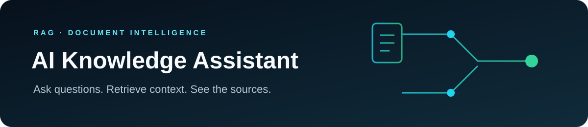
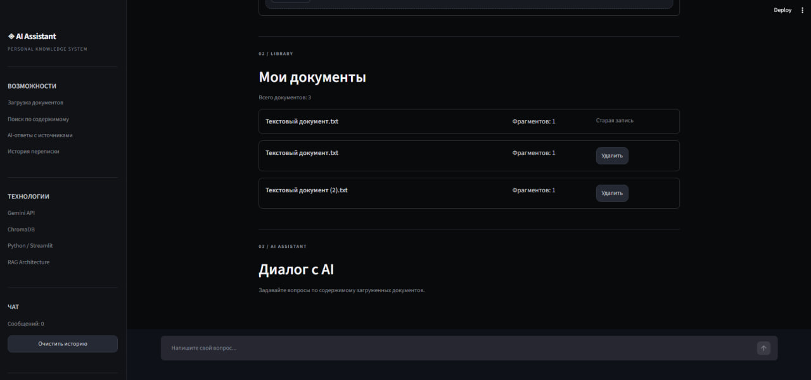
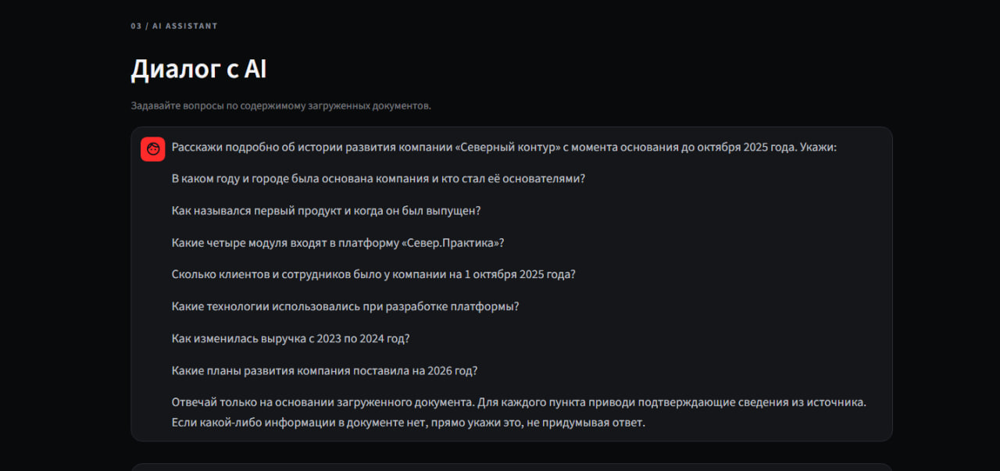
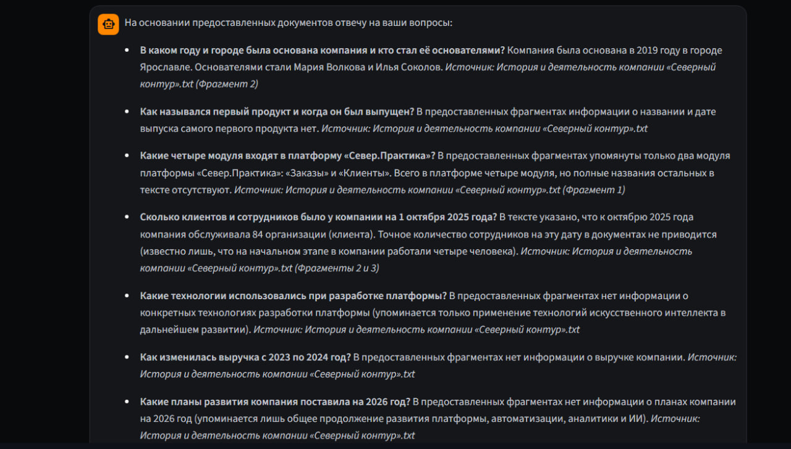
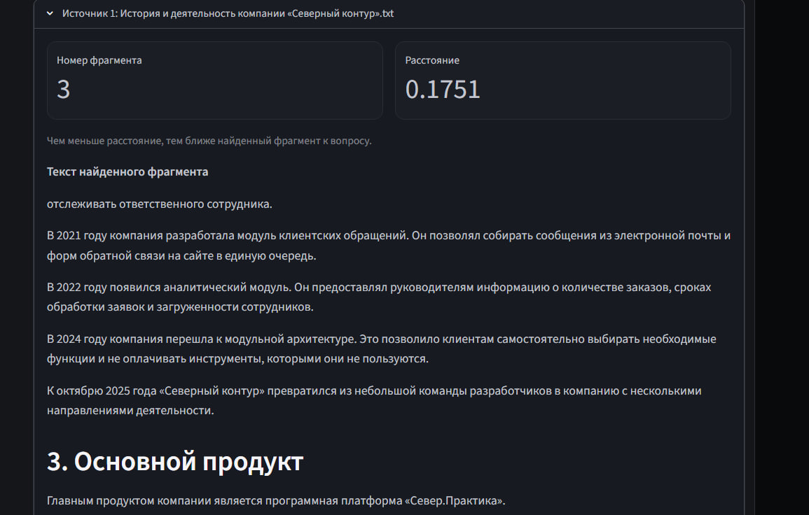
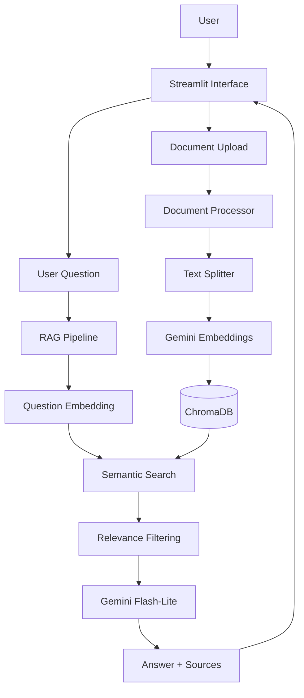

# AI Knowledge Assistant

<div align="center">
  
</div>
<p>
  
  
  
  
  
</p>

**AI Knowledge Assistant** — приложение для поиска информации и ответов на вопросы по загруженным документам с использованием подхода RAG (Retrieval-Augmented Generation).

Пользователь загружает документ, задаёт вопрос на естественном языке и получает ответ, сформированный на основе найденных фрагментов документа. Приложение показывает источники, использованные при подготовке ответа.


## Навигация

- [Возможности](#возможности)
- [Архитектура проекта](#архитектура-проекта)
- [Технологии](#технологии)
- [Установка и запуск](#установка-и-запуск)


## Демонстрация работы

Видеодемонстрация приложения: [Посмотреть видео на Google Drive](https://drive.google.com/drive/folders/1uXn2B5RHkVf8cxZVi_pXPY02j6cO50Jg?usp=sharing)

## Скриншоты приложения

### Главный экран



### Пример работы AI Assistant

**1. Пользователь задаёт вопрос**



**2. AI формирует ответ на основе документа**



**3. Проверка источника ответа**


## Возможности

- Загрузка документов в форматах PDF, DOCX и TXT.
- Извлечение текста из документов.
- Разбиение текста на фрагменты (chunks).
- Создание embeddings с помощью Gemini.
- Сохранение фрагментов и векторов в ChromaDB.
- Семантический поиск по содержимому документов.
- Генерация ответов с использованием найденного контекста.
- Отображение источников ответа.
- Просмотр списка загруженных документов.
- Удаление документов.
- Защита от повторного добавления одного и того же документа.
- Чат-интерфейс с историей сообщений в рамках текущей сессии.

## Архитектура проекта

Проект состоит из нескольких основных компонентов:

- **Streamlit UI** — пользовательский интерфейс для загрузки документов и общения с ассистентом.
- **Document Processor** — извлечение текста из загруженных файлов.
- **Text Splitter** — разделение текста на небольшие фрагменты.
- **Embeddings** — преобразование текста в векторные представления с помощью Gemini.
- **ChromaDB** — хранение векторов и текстовых фрагментов.
- **RAG Pipeline** — поиск релевантного контекста и формирование запроса к языковой модели.
- **Gemini** — генерация итогового ответа на основе найденной информации.

### Схема взаимодействия компонентов



## Как работает RAG

1. Пользователь загружает документ.
2. Приложение извлекает из него текст.
3. Текст разбивается на фрагменты размером около 1000 символов с перекрытием 200 символов.
4. Для каждого фрагмента создаётся embedding с помощью Gemini.
5. Фрагменты и их векторные представления сохраняются в ChromaDB.
6. Пользователь задаёт вопрос.
7. Вопрос преобразуется в embedding.
8. ChromaDB находит наиболее близкие по смыслу фрагменты.
9. Найденные фрагменты проходят фильтрацию по порогу релевантности.
10. Подходящий контекст передаётся Gemini вместе с вопросом пользователя.
11. Модель формирует ответ на основе переданных фрагментов.
12. Приложение отображает ответ и использованные источники.

## Примеры работы

Для проверки приложения использовался тестовый документ о компании «ТехноМир».

| Вопрос | Информация в документе |
|---|---|
| В каком году основана компания? | 2018 |
| Сколько сотрудников работает в компании? | 150 |
| Где находится главный офис? | Нижний Новгород |
| Чем занимается компания? | Разработкой программного обеспечения |
| Кто является генеральным директором? | Информация отсутствует |
| Какой годовой оборот компании? | Информация отсутствует |

Если в документе нет ответа на вопрос, приложение должно сообщить об отсутствии достаточной информации, а не придумывать ответ.

## Технологии

| Технология | Назначение |
|---|---|
| Python | Основной язык разработки |
| Streamlit | Пользовательский интерфейс |
| Google Gemini API | Генерация ответов и embeddings |
| ChromaDB | Векторное хранилище |
| PyMuPDF | Извлечение текста из PDF |
| python-docx | Работа с DOCX |
| python-dotenv | Загрузка переменных окружения |

### Используемые модели

- **Gemini Embedding 2** — создание векторных представлений текста.
- **Gemini 3.5 Flash-Lite** — генерация ответов на вопросы пользователя.

## Оценка качества и тестирование

Для оценки RAG-пайплайна предусмотрены отдельные наборы для поиска релевантных фрагментов и генерации ответов.

### 1. Retrieval Evaluation

Набор содержит **32 формулировки** по четырём фактам из тестового документа: по 8 перефразировок для каждого факта. Это позволяет проверить, насколько поиск устойчив к изменению формулировки вопроса.

В отчёте рассчитываются:
- **Hit@1** — доля вопросов, для которых релевантный фрагмент найден на первой позиции.
- **Hit@3** — доля вопросов, для которых релевантный фрагмент попал в первые три результата.
- **MRR (Mean Reciprocal Rank)** — среднее обратное значение ранга первого релевантного фрагмента.

Метрики рассчитываются как по всему набору, так и отдельно по каждому из четырёх фактов. Результаты предыдущего прогона на четырёх вопросах не следует сравнивать напрямую с новым набором из 32 вопросов: для актуальных показателей необходимо выполнить повторную оценку.

### 2. Generation Evaluation

Набор содержит **16 сценариев**:
- вопросы по известным фактам, сформулированные разными способами;
- вопросы о сведениях, которых нет в документе;
- два сценария с попыткой заставить ассистента выдумать отсутствующие данные.

Автоматическая проверка сопоставляет ответ с ожидаемыми фразами или маркерами отказа, а для отвечаемых вопросов дополнительно проверяет, что система вернула источник. Это smoke-test, а не полноценная экспертная оценка смысловой точности, полноты и обоснованности каждого утверждения.

### 3. Запуск проверок

Сначала загрузите через интерфейс файл `evaluation/fixtures/technomir_test_document.txt`. Для воспроизводимого результата используйте тестовый документ без посторонних документов в базе.

Команды выполняются из корневой папки проекта:

Проверка поиска:

```bash
python evaluation/evaluate_retrieval.py
```

Проверка генерации:

```bash
python evaluation/run_evaluation.py
```

Проверка offline unit tests (без Gemini API):

```bash
python -m unittest discover -s tests -v
```

Подробные инструкции и описание метрик находятся в [evaluation/README.md](evaluation/README.md).

## Структура проекта

```text
ai-knowledge-assistant/
│
├── app/
│   ├── main.py
│   ├── document_processor.py
│   ├── text_splitter.py
│   ├── embeddings.py
│   ├── vector_store.py
│   └── rag_pipeline.py
│
├── data/
│   └── documents/
│
├── evaluation/
│   ├── questions.json
│   ├── run_evaluation.py
│   ├── retrieval_questions.json
│   ├── evaluate_retrieval.py
│   └── retrieval_report.json
│
├── screenshots/
│   └── main-interface.jpg
│
├── tests/
│
├── .env.example
├── .gitignore
├── requirements.txt
└── README.md
```

## Установка и запуск

### 1. Клонирование репозитория

```bash
git clone https://github.com/sk8teJ/ai-knowledge-assistant.git
cd ai-knowledge-assistant
```

### 2. Создание виртуального окружения

```bash
python -m venv venv
```

Активация в Windows PowerShell:

```powershell
.\venv\Scripts\Activate.ps1
```

### 3. Установка зависимостей

```bash
pip install -r requirements.txt
```

### 4. Настройка API-ключа

Создайте файл `.env` в корневой папке проекта и добавьте:

```env
GEMINI_API_KEY=your_gemini_api_key
```

Получить API-ключ можно в [Google AI Studio](https://aistudio.google.com/apikey).

Не публикуйте файл `.env` и не добавляйте API-ключ в GitHub.

### 5. Запуск приложения

```bash
python -m streamlit run app/main.py
```

После запуска Streamlit покажет адрес приложения в браузере.

## Ограничения текущей версии

- Качество ответов зависит от качества исходных документов и найденных фрагментов.
- История чата хранится в рамках текущей сессии приложения.
- Для создания embeddings и генерации ответов требуется доступ к Gemini API.
- Полноценная оценка фактической точности и обоснованности ответов требует расширения набора тестов.


